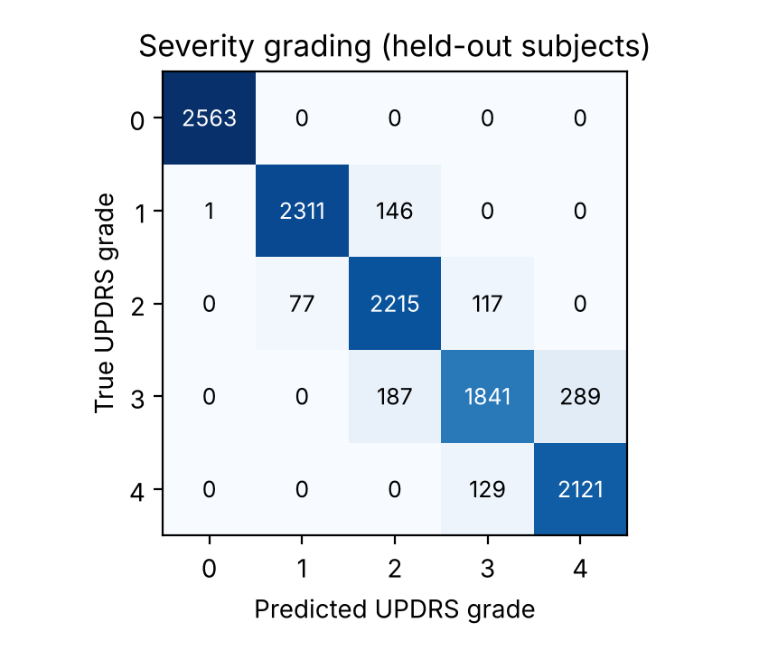
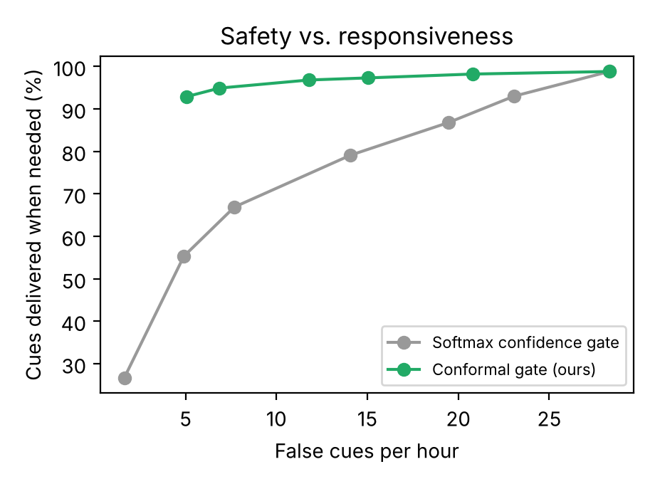
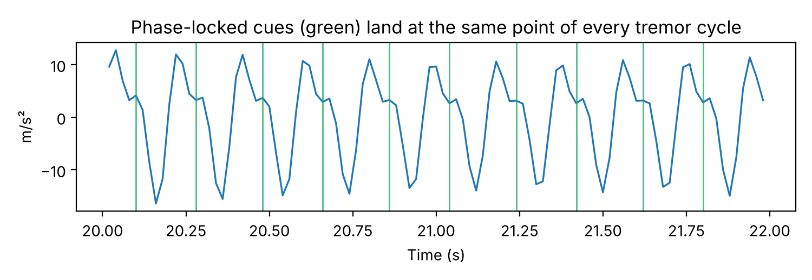
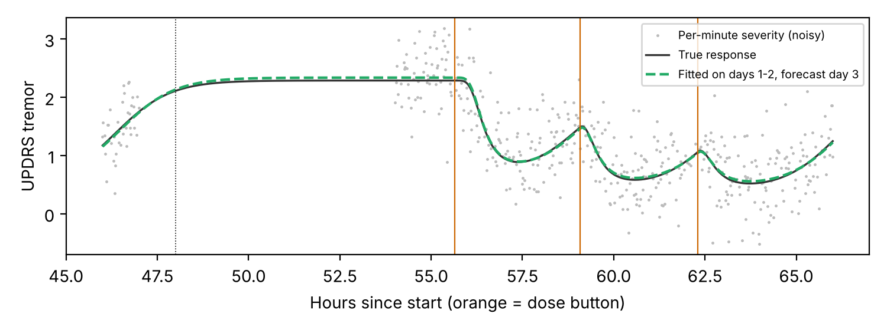
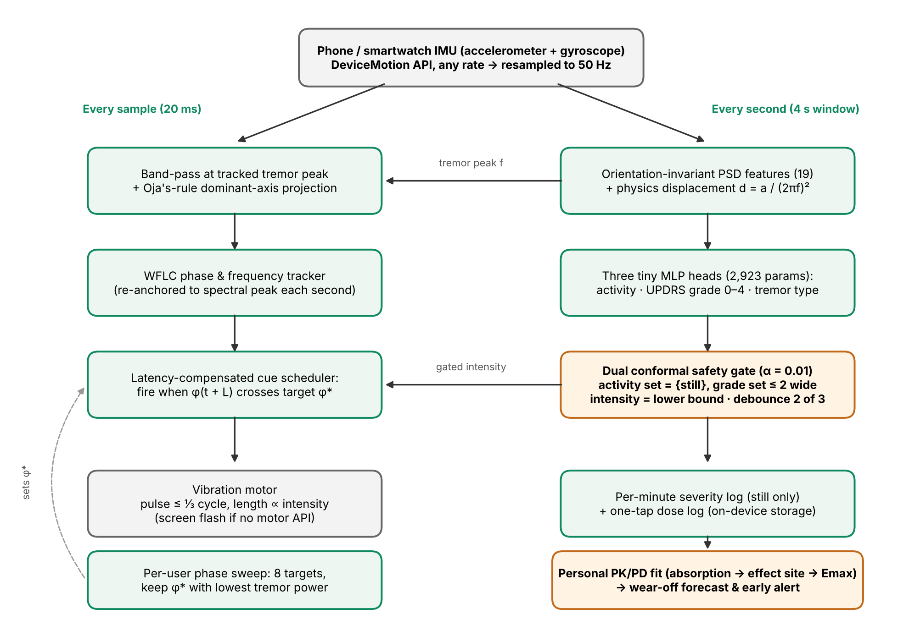

# TremorSense

TremorSense turns an ordinary phone or smartwatch into a tremor monitor for Parkinson's disease and essential tremor. It runs entirely in the browser on the device, with no extra hardware and no cloud.

It does four things that existing tremor apps and wearables don't do together:

1. **Grades severity, not just presence.** It estimates the MDS-UPDRS tremor grade (0 to 4) from how far the hand actually moves, recovered from the accelerometer with physics. It also tells Parkinsonian tremor (4 to 6 Hz, at rest) apart from essential tremor (6 to 11 Hz).
2. **Knows when not to act.** A *dual conformal safety gate* only allows a haptic cue when it is statistically sure the hand is still and sure of the grade. The cue strength is the lowest grade the patient could plausibly have, so it is never stronger than the tremor with 99% coverage.
3. **Times each cue to the tremor's rhythm.** It tracks the tremor's phase sample by sample and fires each short vibration at the same point in every tremor cycle, compensating for motor latency. It can also search for the phase that works best for each person.
4. **Forecasts when medication wears off.** One tap logs a dose. It fits a personal levodopa response model (pharmacokinetic/pharmacodynamic) to that person's own tremor data and predicts the next wear-off before tremor returns.

See [docs/NOVELTY.md](docs/NOVELTY.md) for how each of these differs from published work and patents.

> Research prototype. Not a medical device. All models are trained and evaluated on **simulated** signals (see [Limitations](#limitations)) until clinical data is collected.

## Results (simulated data)

All numbers come from `ml/scripts/evaluate.py` on held-out simulated subjects (380 people, 22,000 one-second decisions, 6.1 hours). They are in [docs/results.json](docs/results.json).

| What | Result |
|---|---|
| Severity grade, exact | 92.1% (macro F1 0.92) |
| Severity grade, within ±1 | 100% |
| Activity (still / using hand / walking / vehicle) | 99.0% |
| Tremor type (Parkinsonian vs essential) | 93.3% |
| Conformal coverage at α = 0.01 | 99.1% severity, 99.0% activity |
| Cues during tremor-free periods | 0 per hour |
| Cue stronger than the true grade | 1.4% of cues (fixed threshold: 46%, softmax gate: 4.4%) |
| Cues delivered when needed | 94.9% (softmax gate at its default: 79.1%) |
| Phase locking (PLV, 1 = perfect) | 0.83 phase-locked vs 0.18 open-loop, 14 ms median jitter |
| Medication curve vs truth (day 3 forecast) | r = 0.975 personal vs 0.914 population average |
| Wear-off time error | 30 min personal vs 52 min population average |
| Model size | 2,923 parameters, 28 KB |
| Compute per decision | 0.35 ms median on a server CPU (the full pipeline in JavaScript) |






## How it works



```
 phone / watch IMU (DeviceMotion, any rate)
        │  resample to 50 Hz
        ▼
 ┌──────────────── every sample ────────────────┐   ┌──────── every second (4 s window) ────────┐
 │ band-pass at tremor peak → Oja dominant axis │   │ orientation-invariant PSD features (19)   │
 │ → WFLC phase/frequency tracker               │◄──┤ + placement → 3 tiny MLPs:                │
 │ → predict phase one actuator-latency ahead   │   │   activity · UPDRS grade · tremor type    │
 │ → fire when it crosses the target phase      │   │ → dual conformal gate → debounce (2 of 3) │
 └───────────────┬──────────────────────────────┘   └───────────────┬───────────────────────────┘
                 │ cue (pulse length ∝ gated grade)                   │ expected grade while still
                 ▼                                                    ▼
           vibration motor                             per-minute log + dose button
                                                                      │
                                                      personal PK/PD fit → wear-off forecast
```

| Module | Python reference | Browser |
|---|---|---|
| Features | `ml/tremorsense/dsp.py` | `web/js/dsp.js` |
| Simulated data | `ml/tremorsense/synth.py` | `web/js/simulator.js` (demo) |
| Model heads | `ml/tremorsense/model.py` | `web/js/model.js` |
| Conformal gate | `ml/tremorsense/conformal.py` | `web/js/conformal.js` |
| Phase tracking and cue timing | `ml/tremorsense/phase.py` | `web/js/phase.js` |
| Medication response | `ml/tremorsense/medcurve.py` | `web/js/medcurve.js` |

The browser modules are checked against the Python reference by `web/test/parity.test.mjs`.

## Run it

**The app** (no build step):

```bash
cd web
python3 -m http.server 8080
# open http://localhost:8080 and press "Start monitoring" in Demo mode
```

Demo mode simulates a patient. You can change severity, tremor type and activity, and load three days of medication data. To use the real phone sensors, the page has to be served over HTTPS and opened on the phone. Motion sensors are only available in secure contexts.

**Train and evaluate:**

```bash
cd ml
pip install -r requirements.txt
python -m scripts.train            # writes web/model/model.json
python -m scripts.evaluate         # writes docs/results.json and docs/figures/
python -m scripts.export_fixtures  # refresh browser parity fixtures
python -m pytest -q
cd ../web && npm test && node test/bench.mjs
```

## Deploying

`.github/workflows/pages.yml` publishes `web/` to GitHub Pages, but only when it is run by hand. A Pages site is public even from a private repository, and publishing before the patent application is filed could count as a public disclosure.

## Limitations

- **No patient data yet.** The training and test data come from a generator built on published tremor physics: UPDRS displacement bands, typical frequencies, and common confounders. The real-world accuracy has to be measured in a clinical study.
- **The medication model** assumes levodopa-like kinetics and was tested on simulated patients that deliberately differ from it. Real dosing regimens (controlled-release, adjuncts) will need extensions.
- **Haptic suppression is not claimed.** The prototype times cues precisely. Whether phase-locked vibration reduces tremor, and at which phase, is a clinical question. The per-user phase search is how the device would find out.
- **iOS Safari has no vibration API,** so cues show as a screen flash there. Android Chrome vibrates. Pulse length stands in for strength because browsers can't set motor amplitude.
