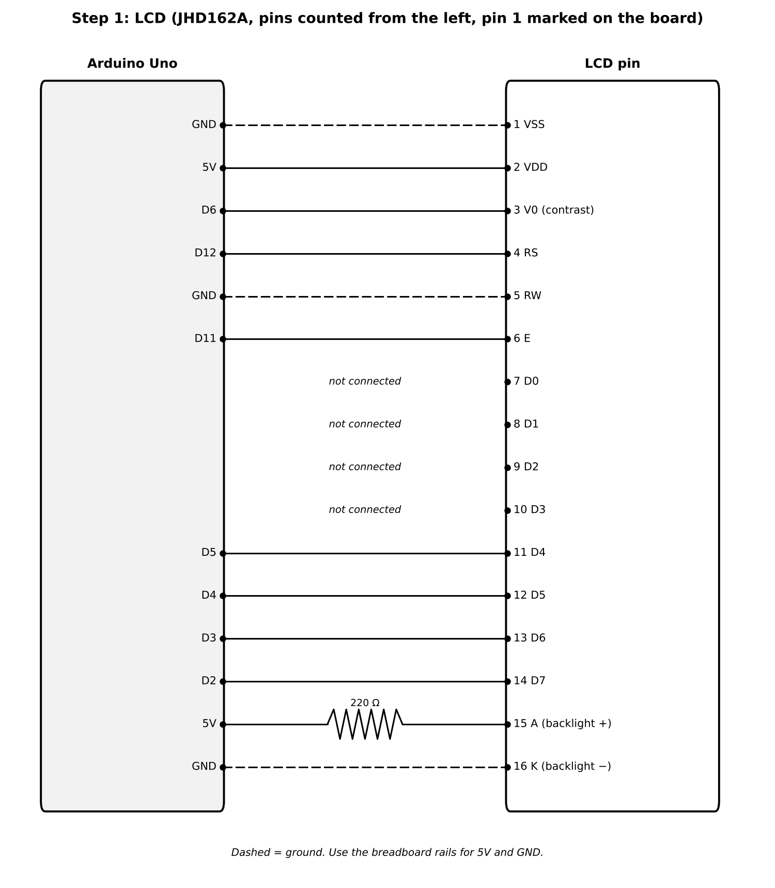
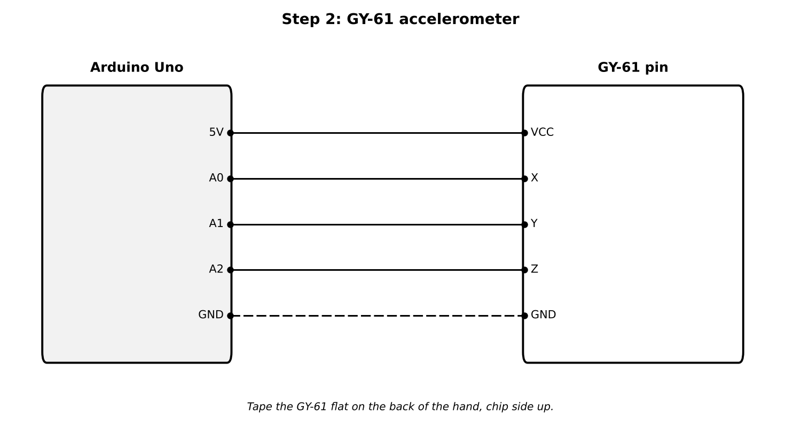
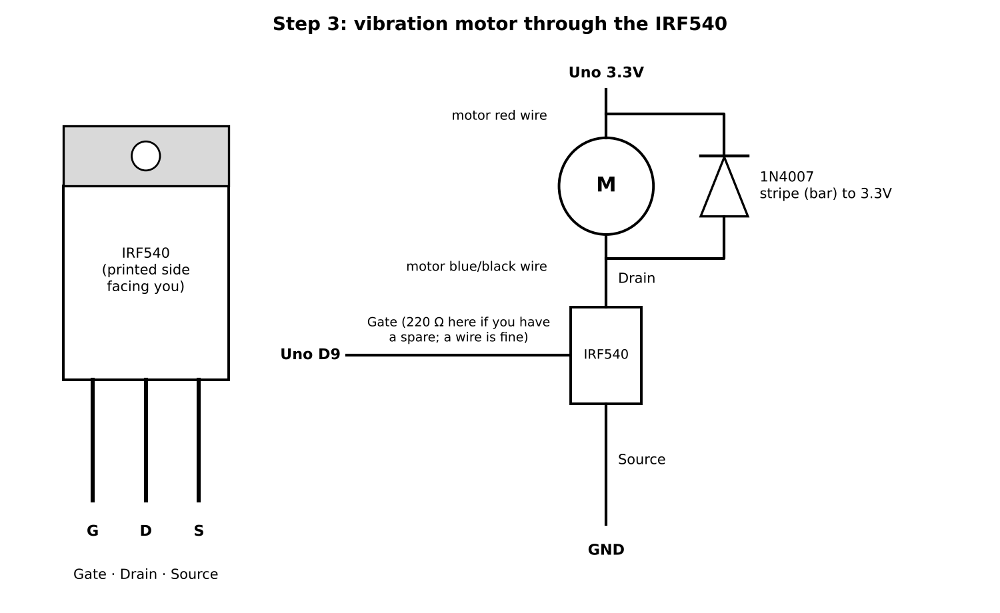
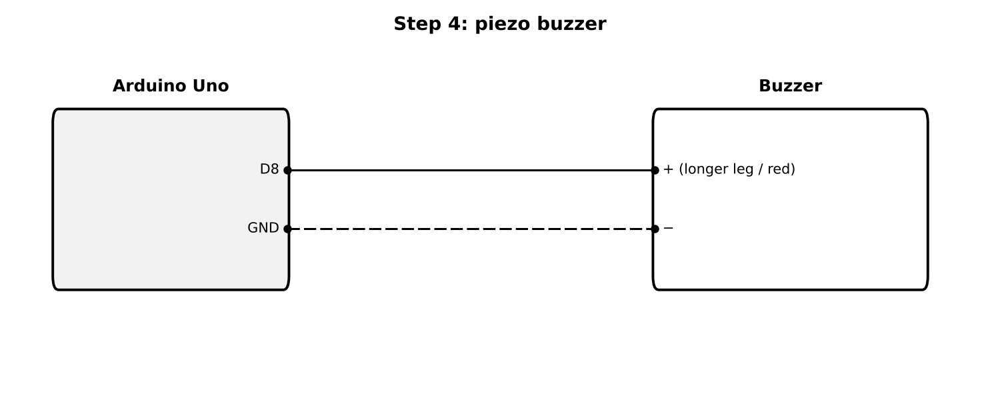

# TremorSense hardware (Arduino Uno)

The same tremor engine as the app, running on an Arduino Uno with an analog
accelerometer, an LCD, a coin vibration motor and a piezo buzzer. It works on
its own, and it can also connect to the TremorSense web app over USB.

Build it one part at a time. Each step has a wiring diagram, a short test
sketch and what you should see before moving on. Unplug the USB cable while
you change wires.

## Parts

| Part | Used for |
|---|---|
| Arduino Uno + USB cable | Controller and power (from the laptop) |
| GY-61 (ADXL335 accelerometer) | Measures hand acceleration on 3 axes |
| JHD162A 16x2 LCD | Shows grade, frequency and cue state |
| Coin vibration motor R-0476 | Vibration cue |
| IRF540 MOSFET | Switches the motor (an Uno pin can't power it directly) |
| 1N4007 diode | Protects the MOSFET from the motor's voltage spike |
| 220 Ω resistor | LCD backlight |
| Piezo buzzer | Beeps and alerts |
| Breadboard, jumper wires | Connections |

## Pin map

| Uno pin | Goes to |
|---|---|
| 5V | Breadboard + rail: LCD pin 2, GY-61 VCC, LCD pin 15 through 220 Ω |
| GND | Breadboard − rail: LCD pins 1, 5, 16, GY-61 GND, MOSFET source, buzzer − |
| 3.3V | Motor red wire and diode stripe |
| A0, A1, A2 | GY-61 X, Y, Z |
| D2, D3, D4, D5 | LCD pins 14, 13, 12, 11 (data D7, D6, D5, D4) |
| D6 | LCD pin 3 (contrast, set in code) |
| D8 | Buzzer + |
| D9 | MOSFET gate |
| D11 | LCD pin 6 (E) |
| D12 | LCD pin 4 (RS) |

## Before you start

1. Install the [Arduino IDE](https://www.arduino.cc/en/software).
2. Connect the Uno by USB. In **Tools → Board** choose *Arduino Uno*, and in
   **Tools → Port** choose the port that appears.
3. The `LiquidCrystal` library is built into the IDE; nothing to install.
4. Put the Uno's **5V** on the breadboard's + rail and **GND** on the − rail.

## Step 1: LCD



- Pin 1 of the LCD is usually marked "1" on the board, at the end farthest
  from pin 16.
- Pins 7 to 10 stay empty (the code uses 4-bit mode).
- The 220 Ω resistor goes between the + rail and pin 15 (backlight +).

**Test:** open `step1_lcd/step1_lcd.ino` and upload it. Open the Serial
Monitor at 115200 baud. The backlight should turn on, and the text
"TremorSense LCD" should appear while the contrast steps from 0 to 140. Note
the value where the text is clearest, and write it into `CONTRAST_DEFAULT` in
`tremorsense_uno/pins.h` and `CONTRAST` in the other test sketches.

**If it doesn't work:**
- Backlight on, but only a row of solid boxes: the contrast is too dark. Watch
  the higher values, or check RS (D12) and E (D11).
- Nothing at all: check pins 1, 2, 15 and 16 and the rails.
- Text appears garbled: one of the four data wires (D2 to D5) is swapped.
- If the contrast from D6 flickers, move the LCD pin 3 wire straight to GND.
  Most JHD162A screens are readable that way.

## Step 2: GY-61 accelerometer



The GY-61 has its own 3.3 V regulator, so it goes on the 5V rail.

**Test:** upload `step2_accel/step2_accel.ino`. With the sensor flat on the
table, the LCD shows about **0.0, 0.0 and 1.0 g** for X, Y and Z (raw counts
around 338, 338 and 405). Tilt the board onto each edge: the axis pointing
down should read about +1 g. **Tools → Serial Plotter** shows the three lines
live; tap the board and they should spike.

**If it doesn't work:** all three axes stuck near 0 or 1023 means VCC or GND
is loose; one axis that never changes means its wire is in the wrong A pin.

For real use, tape the GY-61 flat on the **back of the hand**, chip side up,
with wires long enough to reach the breadboard loosely.

## Step 3: vibration motor



- Hold the IRF540 with the printed side facing you and the legs down: the legs
  are **G**ate, **D**rain, **S**ource from left to right.
- Motor **red** wire to the Uno **3.3V** pin. The coin motor is a 3 V part, and
  3.3 V keeps it within rating.
- Motor **blue or black** wire to the IRF540 **drain**.
- **Source** to the GND rail. **Gate** to **D9** with a plain jumper wire.
- The 1N4007 sits across the motor: the end with the **stripe** goes to the
  3.3V side (red wire), the other end to the drain. If it's the wrong way
  round it shorts the 3.3 V supply, so double-check before powering up.

**Test:** upload `step3_motor/step3_motor.ino`. The motor buzzes weak, medium
and strong, then gives 15 short pulses (like a tremor cue), then rests.

**If it doesn't work:** check the diode direction first, then that source
really goes to GND. A motor that runs all the time means drain and source are
swapped. A very weak buzz at every level can mean the motor wants more than
3.3 V: try its red wire on 5V instead (short pulses only).

## Step 4: buzzer



**Test:** upload `step4_buzzer/step4_buzzer.ino`. You should hear a rising
three-note chirp every two seconds. If the buzzer only clicks or gives one
fixed tone, it is an "active" buzzer; it still works for alerts.

## Step 5: TremorSense firmware

Upload `tremorsense_uno/tremorsense_uno.ino` with everything connected and the
contrast value from step 1 in `pins.h`.

On power-up the buzzer chirps and the LCD shows "TremorSense / Hold hand
still". Every 2 seconds it updates:

| LCD | Meaning |
|---|---|
| `No tremor` / `Hand still` | Nothing above the noise floor |
| `Grade 1  8.2Hz` / `0.6cm  No cue` | Slight tremor: logged, no cue |
| `Grade 3  5.3Hz` / `4.1cm  Cue 3` | Hand still, grade ≥ 2: vibration cues at grade 3 strength |
| `Grade 2  5.1Hz` / `Moving: paused` | Walking or using the hand: no cues |

A short beep marks the moment cueing switches on. Pulses are timed to land at
the same point of every tremor cycle (one motor latency, 40 ms, early) and
last at most a third of a cycle.

To try it without a patient, hold the sensor in your fingertips and shake it
gently and rhythmically at about 5 times a second. Small shakes give grade 1,
bigger ones grade 2 or 3. Then walk around or wave the hand: the LCD should
switch to "Moving: paused".

The Serial Monitor (115200) prints one `G,...` line per update: grade,
frequency × 100, displacement in cm × 100, moving flag and cue strength.

## How the Uno version works

`tremorsense_uno/tremor_core.h` is the engine. It is plain C++, so the same
file runs in the host tests.

- **Sampling:** 50 Hz from the three ADC channels; a slow running mean removes
  gravity on each axis.
- **Spectrum:** Goertzel filters from 0.5 to 12 Hz in 0.5 Hz steps on all
  three axes, with a Hann window over 2 s blocks. Power is summed over the
  axes, so the result doesn't depend on how the sensor is mounted.
- **Grading:** the tremor peak in 3–12 Hz (with sub-bin interpolation) gives
  the frequency. Its power gives peak-to-peak displacement with the same
  physics as the app, d = 2·√(2P)/(2πf)², mapped to the MDS-UPDRS bands
  (< 1 cm, 1–3 cm, 3–10 cm, > 10 cm).
- **Gate:** no cue while movement power below 3 Hz is high (walking, using the
  hand, changing posture). A cue needs grade ≥ 2 in 2 of the last 3 blocks and
  uses the weaker of them.
- **Phase-locked cue:** a band-pass filter at the tracked frequency on the
  strongest axis (zero phase at its centre) finds each upward zero crossing.
  The next pulse starts one cycle later minus the motor latency.

The Uno has 2 KB of RAM, so on its own it uses this rule-based gate. The full
model and the conformal safety gate run in the web app, which drives the Uno
when it is connected (step 6).

The host tests check grading, frequency, displacement, movement gating and
phase locking on simulated GY-61 signals:

```
g++ -std=c++11 -O2 -I hardware/tremorsense_uno hardware/test/test_core.cpp -o /tmp/t && /tmp/t
```

**Limits:** the GY-61 saturates at about ±3.6 g, so displacements above about
10 cm at 5 Hz read low (a 14 cm tremor at 4 Hz still grades 4 in the tests). The 10-bit ADC
resolves about 0.15 m/s², enough for grade 1 tremor and above.

## Step 6: connect to the web app

With the firmware from step 5 on the Uno:

1. Serve the app from the repo: `cd web && python3 -m http.server 8080`.
2. Open `http://localhost:8080` in **Chrome or Edge on the laptop** the Uno is
   plugged into. Web Serial only works in those browsers; the IDE's Serial
   Monitor must be closed, because only one program can use the port.
3. Choose **Arduino (USB)**, press **Start monitoring** and pick the Uno's port
   (it may be listed as "USB Serial" or "Arduino Uno").

The Uno resets when the port opens, then switches to app mode (an **A** in
the last column of the LCD). From then on:

- the Uno streams raw acceleration at 50 Hz;
- the app runs the full TremorSense pipeline with a model trained for the
  GY-61 (no gyroscope, 10-bit ADC, ±3.6 g): grade, activity, tremor type,
  the **dual conformal safety gate** and **phase-locked cues**;
- each cue goes back to the Uno as a motor pulse (PWM duty by grade, at most a
  third of a cycle), timed 50 ms early for the motor spin-up and USB delay;
- the LCD shows the app's grade and cue state, alternating with the
  **medication wear-off forecast** once one exists, and the buzzer sounds once
  15 minutes before the forecast wear-off;
- the phase sweep (**Find my best phase**) works as it does on a phone.

If the app stops sending (tab closed, cable pulled) the Uno goes back to
standalone mode after 5 seconds.

On held-out simulated subjects the GY-61 model grades 90.9% exactly and 100%
within one grade, recognises activity 95.4% of the time, and its grade sets
cover the true grade 98.9% of the time at α = 0.01. Like every result in this
project, these are on simulated data.

## Regenerating the diagrams

```
python3 hardware/docs/make_wiring.py
```
